# Loan Default Risk & IFRS 9 Expected Credit Loss: Northbridge Lending

**SQL (SQLite) · Python (pandas, scikit-learn) · credit scorecard · vintage & roll-rate analysis · IFRS 9 ECL with backtest · Power BI (DAX)**

Northbridge Lending (fictional) is a consumer lender with 50,000 unsecured personal loans issued between 2021 and 2024.
The credit team wants to know **which borrowers and loans default, whether the lender's grade prices that risk, what a
July 2023 policy change did, how much the economy matters, and how big the IFRS 9 loss allowance should be**.

**Summary page:** [`site/index.html`](site/index.html)

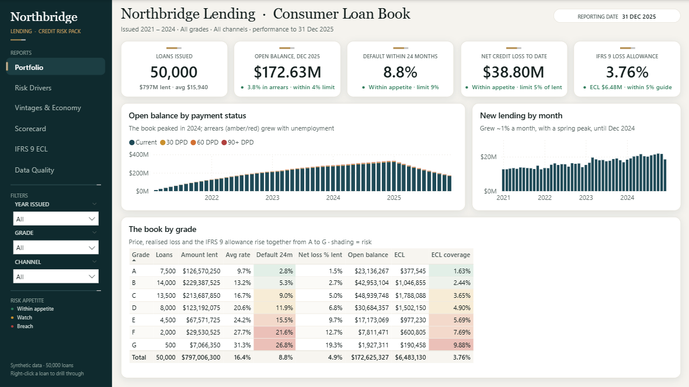

> **About the data.** The dataset is **synthetic**: 50,000 loans and 1.16 million monthly payment records (Jan 2021 – Dec 2025)
> produced by a documented generator ([`scripts/generate_data.py`](scripts/generate_data.py)) laid out like public
> peer-to-peer lending extracts. Default is driven by a known risk score (credit score, debt-to-income, income, purpose, ...),
> an age curve and unemployment, and the extract contains the problems real ones have (income stored as text, two date
> formats, typos, invalid codes, duplicates, test loans). Because the generator records the truth
> ([`data_raw/true_effects.json`](data_raw/true_effects.json)), every cleaning step, model and estimate is **checked against it**.

## Key results

| | Result | So what |
|---|---|---|
| 1 | **$797M lent in 50,000 loans; 8.8% of loans issued 2021-23 defaulted within 24 months.** $51.6M charged off, $12.8M recovered: **net loss $38.8M**. | The size of the problem. |
| 2 | **The lender's grade ranks risk well: 2.8% (A) to 26.8% (G) default within 24 months**, and the price rises with it (9.4% to 30.9% interest). | Pricing is broadly risk-based. |
| 3 | **Credit score is the strongest single driver** (information value 0.23): borrowers at 620-659 default 7.6x as often as those at 780+. **Small-business (14.0%) and medical (11.9%) loans are the riskiest purposes; car loans the safest (6.7%).** | Where to tighten criteria. |
| 4 | **The July 2023 policy change (online debt-to-income limit 40% → 50%) added 595 loans that default 1.7x as often** (6.4% vs 3.8% in 12 months). They pay 5.3 pts more interest, which covers the ~1.9 pts a year of extra expected loss. | The policy is riskier but priced; keep it, monitor it. |
| 5 | **The 2023 vintage is the worst: 10.1% defaulted by month 24 vs 7.1% for 2021.** It met the 2024 unemployment peak early in life. Estimated sensitivity: **+1 pt unemployment = +35% default starts (true value: +35%)**. | Losses are cyclical; the allowance must look forward. |
| 6 | **Half of loans 30 days late cure; the other half roll to 60 days, and half of those to default.** Loss given default is **72%** (66% for borrowers with a mortgage, 77% for renters). | Early collections pay off. |
| 7 | **The application scorecard beats the lender's grade out of time: Gini 0.38 vs 0.32 on 2023 loans** (KS 0.29; worst band defaults 9.7x as often as the best). All 15 estimated effects have the true sign (correlation with the truth 0.97). A gradient-boosting challenger scored higher in development (0.45) but not out of time (0.37). | A transparent scorecard is the better tool here. |
| 8 | **IFRS 9 ECL at 31 Dec 2025: $6.48M on a $172.6M open book (3.76% coverage)**: Stage 1 2.18%, Stage 2 9.2%, Stage 3 72.7%. Downside scenario $8.22M, upside $5.54M. | The loss allowance to book, with its sensitivity. |
| 9 | **Backtest: at Dec 2024 the model expected 1,525 defaults in 2025; 1,290 happened.** With 2025's actual unemployment (which fell) it would have expected 1,371, within 6%. | The PD model is sound; the gap is the prudent economic outlook. |

## Approach

| Step | Script | What it does |
|---|---|---|
| 1 | [`generate_data.py`](scripts/generate_data.py) | Synthetic loan book: borrowers, true default process (logistic risk score × age curve × unemployment), lender grade with noise, monthly payments, delinquency and cures, prepayments, charge-offs at 120 days, recoveries over 12 months, plus extract problems |
| 2 | [`clean.py`](scripts/clean.py) | Cleans the extract into SQLite (`northbridge.db`): every fix logged in `dq_log` next to the number injected; one outcome row per loan (`loan_outcomes`) |
| 3 | [`sql/analysis.sql`](sql/analysis.sql) | Nine credit questions in SQL: default by grade, purpose, score and DTI band, vintage curves, roll rates (self-join on month + 1), LGD, policy change, defaults vs unemployment. Results: [`sql/results.md`](sql/results.md) |
| 4 | [`model.py`](scripts/model.py) | Application scorecard: binning, Weight of Evidence, logistic regression, points (600 = 50:1 odds, 20 points to double); out-of-time test; benchmarks; truth check |
| 5 | [`ecl.py`](scripts/ecl.py) | IFRS 9 ECL at Dec 2025 and Dec 2024, using only data known at each date; backtest of the Dec 2024 PDs against 2025 defaults |
| 6 | [`export_powerbi.py`](scripts/export_powerbi.py), [`make_charts.py`](scripts/make_charts.py), [`build_pbip.py`](scripts/build_pbip.py) | Power BI tables and findings, README charts, the Power BI project |

### Data quality

| Problem in the extract | Rows | Injected | Fix |
|---|---:|---:|---|
| Exact duplicate rows | 400 | 400 | removed |
| Test loans (`TEST-` ids, amount 1.00) | 12 | 12 | removed |
| Issue date as `Apr-2023` (broker feed) | 7,525 | 7,525 | parsed, day set to the 1st and flagged |
| Income stored as text (`$72,000.00`) | 1,500 | 1,500 | symbols stripped |
| Income missing | 300 | 300 | kept, flagged (imputed only inside the model) |
| Employment length `n/a` | 1,750 | 1,750 | null |
| Purpose with odd case or spaces | 2,500 | 2,500 | normalised |
| Region typos | 150 | 150 | mapped |
| DTI codes -1 / 999 | 60 | 60 | null |
| Credit score missing | 200 | 200 | kept, flagged |
| Home ownership `ANY` / `NONE` | 25 | 25 | grouped as OTHER |
| Duplicate monthly payment rows | 300 | 300 | removed |

50,412 extract rows → **50,000 clean loans**; every fix equals the number of problems the generator planted.

## Findings

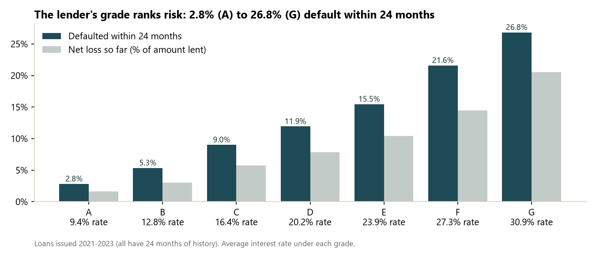

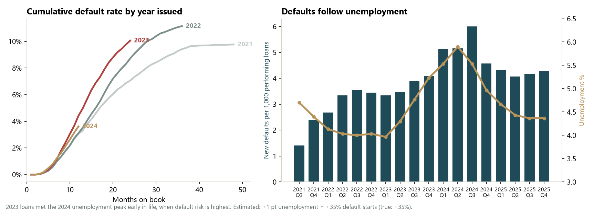

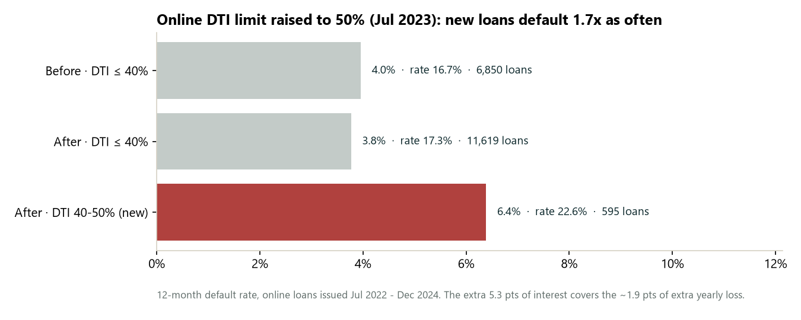

## Application scorecard

Trained on loans issued 2021-22 (24-month default 7.9%), tested on 2023 loans it never saw. Characteristics are binned,
each bin gets a Weight of Evidence, and a logistic regression on the WoE values becomes a points table
(`data_clean/scorecard.csv`; Power BI *Scorecard* page). A plain logistic regression on the raw fields recovers the
generator's true coefficients (15 of 15 signs; e.g. credit score −0.135 per 10 points vs −0.130 true, DTI 0.035 vs 0.035).

| Model | Gini (2021-22, development) | Gini (2023, out of time) | KS (out of time) |
|---|---:|---:|---:|
| Scorecard (logistic regression on WoE) | 0.39 | **0.38** | 0.29 |
| Lender grade A-G | 0.33 | 0.32 | 0.22 |
| Gradient boosting (challenger) | 0.45 | 0.37 | 0.27 |

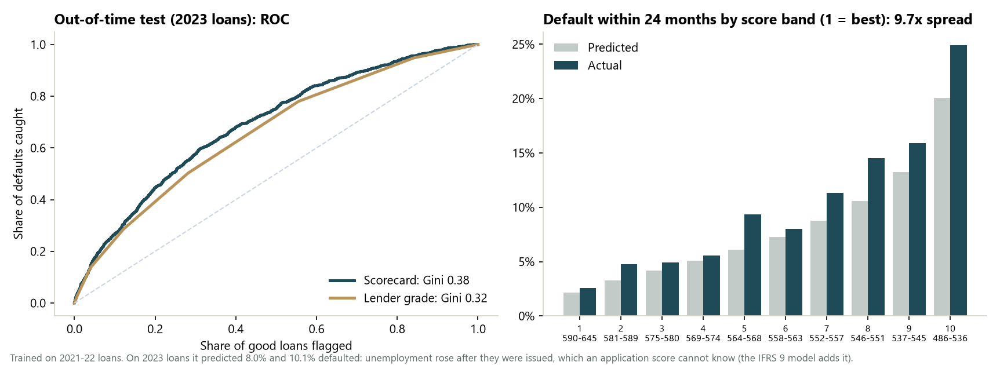

On 2023 loans the scorecard predicted 8.0% defaults and 10.1% happened: unemployment rose after those loans were
issued, which an application score cannot know. That is the job of the forward-looking adjustment in the ECL.

## IFRS 9 expected credit loss

| | Method (all estimated only from data known at the reporting date) |
|---|---|
| **Staging** | Stage 3: 90+ days past due (credit-impaired). Stage 2: 30-89 days past due, or cured from arrears in the last 6 months (significant increase in credit risk). Stage 1: the rest. |
| **PD** | Monthly chance that a current loan starts a default, by months on book, scaled by score band, by a probation multiplier for recently cured loans, and by unemployment (sensitivity estimated from history: 0.30 per point, true 0.30). 12-month PD for Stage 1, lifetime PD for Stage 2, early repayment included. Loans already 30/60 days late use observed roll rates. |
| **LGD** | 1 − recovery rate on charge-offs with a complete 12-month workout, by home ownership (66% – 77%). |
| **EAD** | Outstanding balance at the reporting date. |
| **Scenarios** | Unemployment −0.7 / flat / +1.5 points, weighted 20 / 60 / 20%. |

| 31 Dec 2025 | Loans | Exposure | ECL | Coverage |
|---|---:|---:|---:|---:|
| Stage 1 | 19,572 | $152.0M | $3.32M | 2.18% |
| Stage 2 | 2,236 | $18.6M | $1.72M | 9.20% |
| Stage 3 | 178 | $2.0M | $1.45M | 72.7% |
| **Total** | **21,986** | **$172.6M** | **$6.48M** | **3.76%** |

The allowance was $15.75M (4.77%) a year earlier on a larger book. Of the 2,713 Stage 2 loans at Dec 2024, 55% were back
in Stage 1 a year later and 13% had been written off.

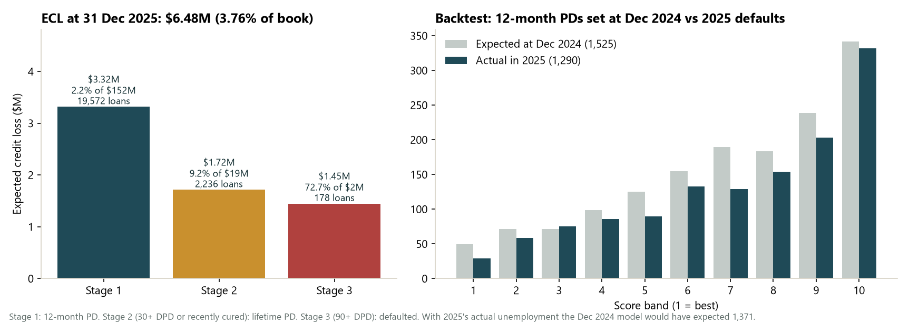

**Simplifications** (a production model would add them): no discounting at the effective interest rate, EAD is the current
balance (no amortisation within the horizon), one macro variable, and the significant-increase test uses arrears history
rather than a behavioural score.

## Power BI dashboard

Six pages styled as a lender's **credit risk pack**: teal-ink and brass palette, serif titles, a reporting-date chip, and
**risk appetite flags** on the KPI tiles (green / amber / red against board limits, recalculated for any filter). Synced
Year issued / Grade / Channel filters, a **Loan Detail** drill-through (payment history month by month) and a month
tooltip. Details: [`powerbi/DESIGN.md`](powerbi/DESIGN.md).

| Portfolio | Risk Drivers |
|---|---|
|  | 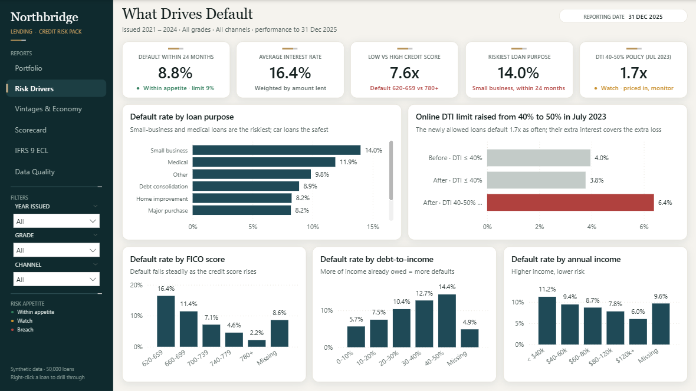 |
| **Vintages & Economy** | **Scorecard** |
| 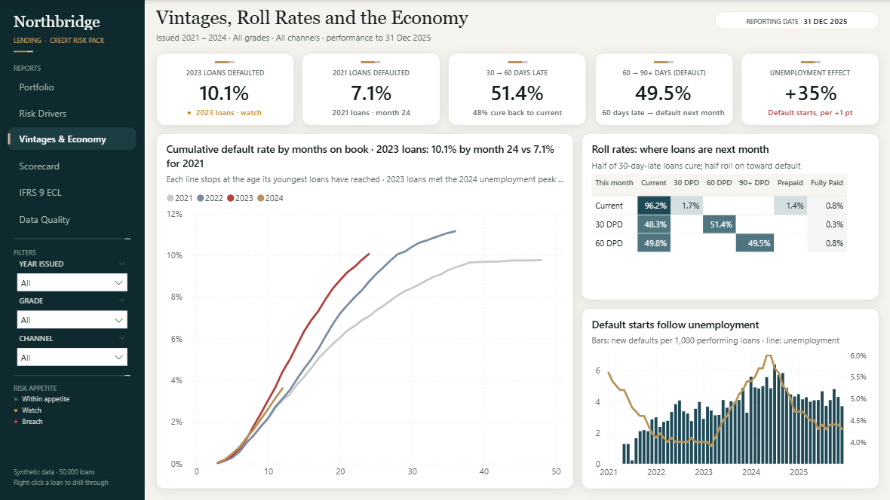 | 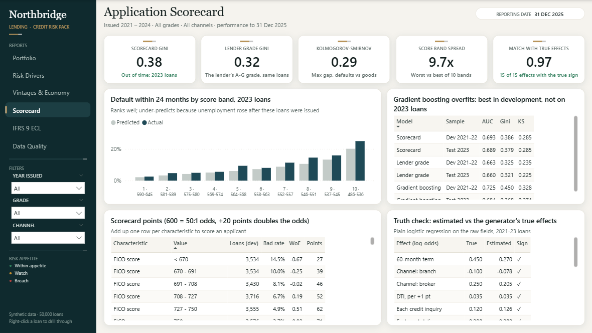 |
| **IFRS 9 ECL** | **Data Quality** |
| 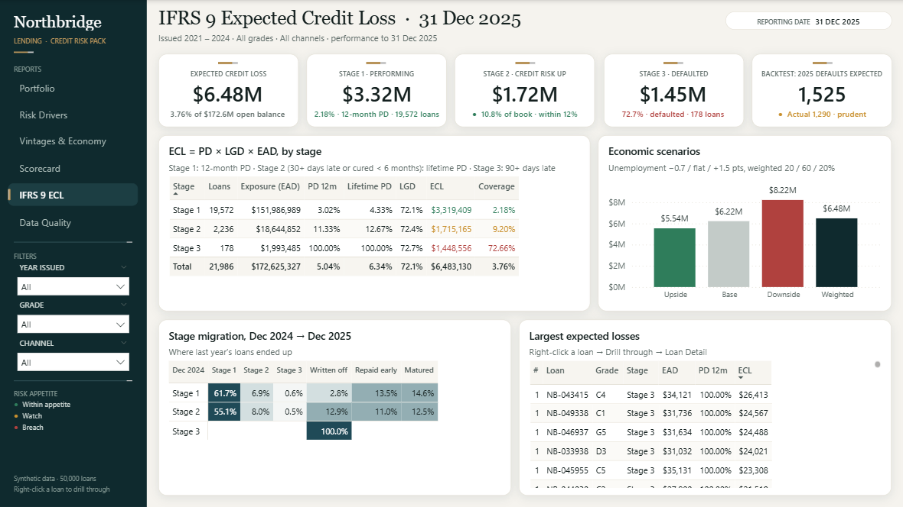 | 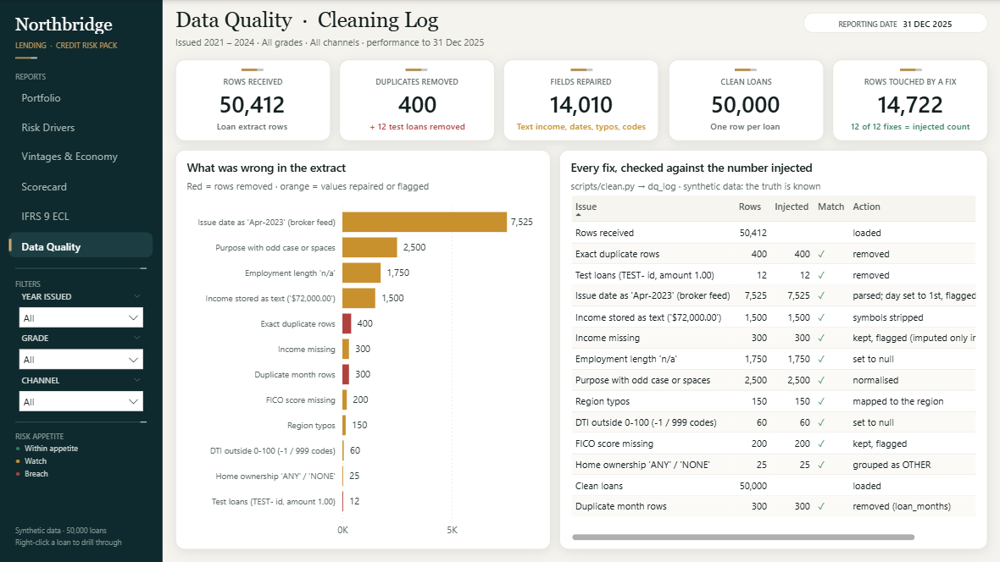 |

**Loan Detail** (drill-through from any loan): the application, the score, the IFRS 9 numbers and the payment history.

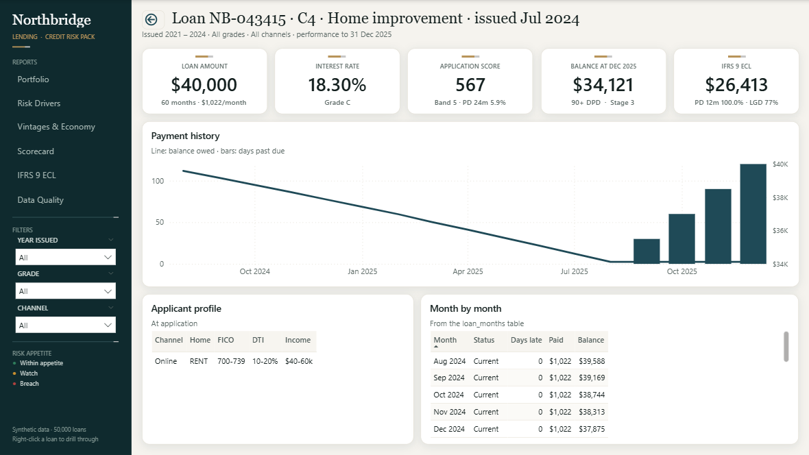

* **Model:** a loan table (50,000 rows) and its month-by-month history (1.16M rows) so every filter reaches every page;
  ECL per loan at two dates; scorecard, backtest and data-quality tables; 167 measures. Vintage curves are computed in DAX
  from the loan table, so they respond to the filters. Totals match Python exactly (50,000 loans, $797.0M lent,
  4,666 defaults, ECL $6,483,130).
* Saved as a **Power BI Project** ([`powerbi/Northbridge.pbip`](powerbi/Northbridge.pbip)) generated by
  [`scripts/build_pbip.py`](scripts/build_pbip.py).

## How to run

```bash
pip install pandas numpy scikit-learn matplotlib tabulate
python scripts/generate_data.py     # synthetic raw files -> data_raw/   (~15 s, seeded)
python scripts/clean.py             # -> data_clean/northbridge.db
python scripts/run_sql.py           # -> sql/results.md
python scripts/model.py             # scorecard
python scripts/ecl.py               # IFRS 9 ECL + backtest
python scripts/export_powerbi.py    # Power BI tables + findings
python scripts/make_charts.py       # README charts
python scripts/build_pbip.py        # Power BI project -> powerbi/Northbridge.pbip
```
The raw monthly file (67 MB) and the SQLite database are not committed; the generator recreates them exactly.

## Tools
SQL (SQLite: CTEs, window functions, self-joins) · Python (pandas, NumPy, scikit-learn: logistic regression, gradient
boosting) · credit risk (WoE scorecard, Gini/KS, vintages, roll rates, LGD, IFRS 9 staging and ECL, backtesting) ·
Power BI (DAX, Power Query, PBIP/TMDL)
